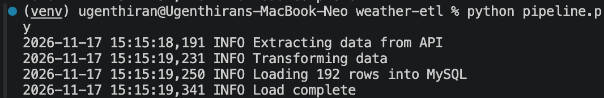
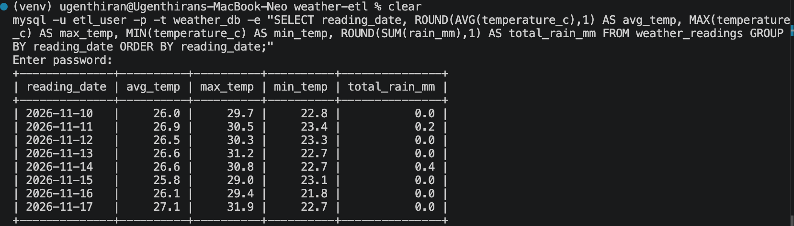

# Weather ETL Pipeline

A Python and MySQL data pipeline that collects hourly weather data for Coimbatore from a public API, cleans it, stores it in a database, and analyses it with SQL.

## How it works

```
Open-Meteo API -> Python (Extract) -> pandas (Transform) -> MySQL (Load) -> SQL analysis
```

1. **Extract:** calls the free Open-Meteo REST API for the last 7 days of hourly temperature, humidity and rainfall.
2. **Transform:** cleans the data with pandas. It renames columns, fixes data types, removes missing values and duplicates, and adds date and hour-of-day columns.
3. **Load:** writes the rows into a MySQL table using an upsert, so running the pipeline again never creates duplicate rows (idempotent).
4. **Analyse:** SQL queries use GROUP BY, CTEs and window functions to find daily trends and the hottest hours.

## Tech stack

Python, pandas, requests, SQLAlchemy, PyMySQL, MySQL, SQL, Git

## Project files

| File | Purpose |
|---|---|
| `pipeline.py` | The ETL pipeline (extract, transform, load) |
| `schema.sql` | Creates the `weather_readings` table |
| `analysis.sql` | SQL queries for analysis |
| `requirements.txt` | Python libraries needed |

## Setup

1. Install Python 3 and MySQL, then create a database and a user:
   ```sql
   CREATE DATABASE weather_db;
   CREATE USER 'etl_user'@'localhost' IDENTIFIED BY 'your_password';
   GRANT ALL PRIVILEGES ON weather_db.* TO 'etl_user'@'localhost';
   ```
2. Clone the repository and install the libraries:
   ```
   git clone https://github.com/ugenthiran26/weather-etl.git
   cd weather-etl
   python3 -m venv venv
   source venv/bin/activate
   pip install -r requirements.txt
   ```
3. Create a `.env` file in the project folder:
   ```
   DB_HOST=localhost
   DB_USER=etl_user
   DB_PASSWORD=your_password
   DB_NAME=weather_db
   ```
4. Create the table and run the pipeline:
   ```
   mysql -u etl_user -p weather_db < schema.sql
   python pipeline.py
   ```
5. Run the analysis:
   ```
   mysql -u etl_user -p -t weather_db < analysis.sql
   ```
## Screenshots

### Pipeline run


### Daily summary (SQL)

## Sample result: day-over-day temperature change

| reading_date | avg_temp (C) | change_from_prev_day |
|---|---|---|
| 2026-11-10 | 26.0 | NULL |
| 2026-11-11 | 26.9 | 0.9 |
| 2026-11-12 | 26.5 | -0.4 |
| 2026-11-13 | 26.6 | 0.1 |
| 2026-11-14 | 26.6 | 0.0 |
| 2026-11-15 | 25.8 | -0.7 |
| 2026-11-16 | 26.1 | 0.3 |
| 2026-11-17 | 27.1 | 1.1 |

## What I learned

- How an ETL pipeline moves data from an API to a database
- Cleaning and reshaping data with pandas
- Designing a MySQL table with a unique key and writing idempotent upserts
- Writing SQL with aggregations, CTEs and window functions
- Keeping secrets out of code with a `.env` file and `.gitignore`

## Possible improvements

- Schedule the pipeline to run daily
- Add a second data source and join the tables in SQL
- Build a simple dashboard from the results